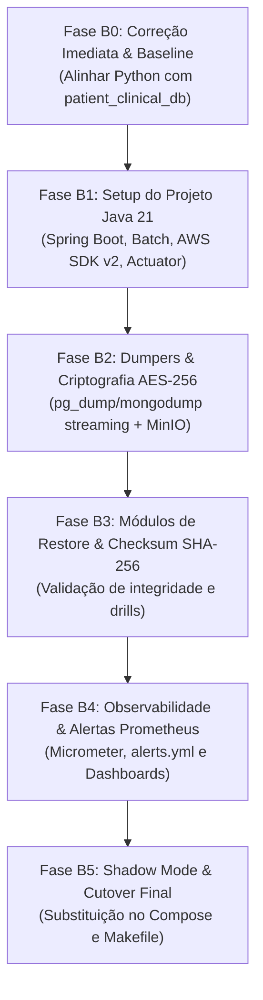

# Plano de Migração do Backup Service: Python para Java 21 (Spring Boot 3.x / Spring Batch) e Orquestração Corporativa de Disaster Recovery

Este documento detalha o passo a passo completo, o mapeamento técnico e a arquitetura de resiliência necessários para migrar o **Backup Service** do ecossistema Promptuário da sua stack atual em Python (Alpine / subprocess / schedule / boto3) para a stack corporativa padronizada do Projeto Integrador: **Java 21 (LTS), Spring Boot 3.3+ com Spring Batch / Scheduling, AWS SDK for Java 2.x e Spring Boot Actuator**.

> **Atualização Arquitetural Crítica (Pós-Unificação Fase 12):**  
> Os bancos legados independentes `patient_db` e `clinical_db` foram formalmente consolidados no banco unificado **`patient_clinical_db`** (hospedado no container `db-patient-clinical`).  
> O Backup Service atual em Python continha uma defasagem tentando se conectar aos hosts legados inexistentes `db-patient` e `db-clinical`. Este plano de migração corrige essa dívida técnica, integrando a topologia unificada completa (PostgreSQL unificado, IAM, Reporting, MongoDB AI e Object Storage MinIO) com garantia de RPO (Recovery Point Objective), RTO (Recovery Time Objective), conformidade com a LGPD (criptografia em repouso AES-256) e métricas exportadas para o Prometheus.

---

## 1. Mapeamento de Stack Tecnológica

Equivalência 1-para-1 de cada tecnologia que compõe o serviço de backup atualmente:

| Componente | Atual (Python) | Destino (Java 21 / Spring Boot 3.x) |
| :--- | :--- | :--- |
| **Linguagem Base** | Python 3.12 (Alpine Linux) | Java 21 (LTS) / Eclipse Temurin JRE 21 Alpine |
| **Framework Base** | Script procedural (`backup_runner.py`) | Spring Boot 3.3+ com Spring Batch e Spring Task Scheduling |
| **Agendamento Periódico** | Biblioteca Python `schedule` (loop `time.sleep`) | `@Scheduled` (cron express) / Spring TaskScheduler configurável |
| **Execução de Dumps** | `subprocess.run` chamando `pg_dump` e `mongodump` | `ProcessBuilder` seguro com streaming de I/O em buffers controlados |
| **Compressão de Artefatos** | `gzip` nativo em memória/disco | Java `GZIPOutputStream` em pipeline stream (baixo consumo de RAM) |
| **Criptografia em Repouso (LGPD)** | Inexistente (arquivos abertos `.sql.gz`) | Criptografia simétrica autenticada **AES-256-GCM** via Java Cryptography Extension (JCE) |
| **Verificação de Integridade** | Inexistente | Cálculo de **SHA-256 Checksum** gravado junto ao manifesto do backup |
| **Integração MinIO / S3** | `boto3` / `botocore` | **AWS SDK for Java 2.x** (`S3Client` / `S3TransferManager`) |
| **Política de Retenção** | Varredura com `rglob` e `list_objects_v2` | Serviço de retenção agendado com deleção em lote (`DeleteObjectsRequest`) |
| **Interface Operacional / CLI** | `argparse` (`--once`, `--restore`, `--kind`, `--file`) | Spring Boot CLI Runner (`CommandLineRunner` / Picocli) + REST API controlada |
| **Autenticação de API (Operacional)**| Inexistente (apenas CLI) | Spring Security (OAuth2 Resource Server / JWT) para endpoints HTTP |
| **Relatório de Status** | Arquivo local `status.json` | API REST `/api/v1/backups/status` + persistência em `status.json` + Actuator |
| **Observabilidade e Métricas** | Logs em texto (`backup.log`) | **Spring Boot Actuator + Micrometer Prometheus** (métricas de latência, taxa e falhas) |

---

## 2. Estrutura de Diretórios Equivalente (Clean Architecture / Enterprise DR)

A organização respeita a separação de responsabilidades em camadas, separando orquestração de jobs, dumpers de banco, criptografia, upload e controladores:

### Origem (Python / Procedural):
```text
backend/backup/
├── Dockerfile                  # Base python:3.12-alpine com postgresql-client e mongodb-tools
└── backup_runner.py            # Script monolítico com dump, restore, minio e schedule
```

### Destino (Java 21 / Spring Boot 3.x):
```text
backend-java/backup-service/
├── pom.xml
├── Dockerfile                  # Multi-stage build com JRE 21 Alpine + pg_dump + mongodump
└── src/main/java/br/edu/ifrn/promptuario/backup/
    ├── BackupServiceApplication.java
    ├── config/
    │   ├── BackupProperties.java       # @ConfigurationProperties (agendamentos, retenção, diretórios)
    │   ├── S3StorageConfig.java        # Bean S3Client (MinIO) com retry e timeouts
    │   ├── SecurityConfig.java         # Proteção dos endpoints operacionais com JWT
    │   └── AsyncConfig.java            # ThreadPoolTaskScheduler dedicado
    ├── controller/
    │   ├── BackupOperationController.java # Endpoints /api/v1/backups/execute, /status, /history
    │   └── RestoreOperationController.java# Endpoints /api/v1/backups/restore
    ├── model/
    │   ├── BackupJobExecution.java     # Registro de execução do ciclo de backup
    │   ├── DatabaseBackupResult.java   # Resultado de cada banco individual
    │   ├── BackupManifest.java         # Metadados do artefato (tamanho, checksum SHA-256, criptografia)
    │   ├── DatabaseTarget.java         # Enum (IAM, PATIENT_CLINICAL, REPORTING, MONGO_AI, MINIO_BUCKETS)
    │   └── ExecutionMode.java          # Enum (SCHEDULED, MANUAL, CLI, RESTORE)
    ├── service/
    │   ├── BackupOrchestratorService.java # Coordenação do ciclo completo de backup
    │   ├── RestoreOrchestratorService.java# Coordenação de restauração controlada
    │   ├── RetentionCleanupService.java   # Limpeza local e no MinIO por janela de expiração
    │   ├── CryptoService.java             # Criptografia e decodificação AES-256-GCM
    │   └── StatusReportService.java       # Geração de status.json e cache em memória
    ├── dumper/
    │   ├── DatabaseDumper.java         # Interface comum para dumpers
    │   ├── PostgresDatabaseDumper.java # Execução streaming de pg_dump
    │   ├── MongoDatabaseDumper.java    # Execução de mongodump --gzip --archive
    │   └── MinioBucketsDumper.java     # Snapshot de integridade dos buckets S3
    ├── restorer/
    │   ├── DatabaseRestorer.java       # Interface comum para restores
    │   ├── PostgresDatabaseRestorer.java# Restauração controlada via psql
    │   └── MongoDatabaseRestorer.java  # Restauração controlada via mongorestore
    ├── storage/
    │   └── S3BackupStorageService.java # Upload, download, listagem e expurgo de artefatos S3
    ├── metrics/
    │   └── BackupMetricsService.java   # Micrometer Gauges e Counters para Prometheus
    └── cli/
        └── BackupCommandLineRunner.java# Suporte a argumentos CLI (--once, --restore, etc.)
```

---

## 3. Mapeamento de Alvos e Topologia de Bancos (Pós-Unificação)

A topologia auditada pós-Fase 12 do PROMPTUÁRIO define 4 instâncias de banco de dados e 3 buckets de storage como alvos obrigatórios de contingência:

| Alvo | Tipo | Host Docker | Banco / Destino | Credencial Padrão | Estratégia de Dump | RPO Alvo |
| :--- | :--- | :--- | :--- | :--- | :--- | :--- |
| **IAM DB** | PostgreSQL 15 | `db-iam:5432` | `iam_db` | `iam` / `iam_pass` | `pg_dump -U iam iam_db` | 24h |
| **Patient-Clinical DB** *(Unificado)* | PostgreSQL 15 | `db-patient-clinical:5432` | `patient_clinical_db` | `clinical` / `clinical_pass` | `pg_dump -U clinical patient_clinical_db` | 24h |
| **Reporting DB** | PostgreSQL 15 | `db-reporting:5432` | `reporting_db` | `reporting` / `reporting_pass` | `pg_dump -U reporting reporting_db` | 24h |
| **AI DB** | MongoDB 6/7 | `db-ai:27017` | `ai_db` | `ai` / `ai_pass` | `mongodump --db=ai_db --archive` | 24h |
| **Object Storage Docs** | MinIO (S3) | `minio:9000` | `patient-documents` | `promptuario` / `promptuario_pass` | Snapshot metadata / Sync S3 | 24h |
| **Object Storage Prescrições** | MinIO (S3) | `minio:9000` | `prescriptions` | `promptuario` / `promptuario_pass` | Snapshot metadata / Sync S3 | 24h |
| **Object Storage Relatórios** | MinIO (S3) | `minio:9000` | `reports` | `promptuario` / `promptuario_pass` | Snapshot metadata / Sync S3 | 24h |

> **Atenção:** Os bancos legados `patient_db` e `clinical_db` são removidos da lista de dumps ativos e mantidos apenas como artefatos históricos frios em `.phase12-backups/`.

---

## 4. Arquitetura de Execução, Resiliência e Compliance LGPD

### 1. Pipeline de Dump em Stream com Criptografia (Zero Plaintext Leak)
No modelo legado, o dump era gerado em arquivo texto temporário comprimido em gzip. Na nova arquitetura Java, a pipeline é encadeada em stream:
```text
ProcessBuilder (pg_dump)
       │ (stdout stream)
       ▼
GZIPOutputStream (Compressão)
       │
       ▼
CipherOutputStream (AES-256-GCM com chave simétrica rotacionada)
       │
       ├──► FileOutputStream (/var/backups/.../postgres_patient_clinical_db.enc.gz)
       │    + DigestOutputStream (Cálculo de Hash SHA-256 em tempo real)
       │
       ▼
S3Client.putObject (Upload direto para bucket MinIO 'backups')
```

### 2. Metadados e Manifesto de Integridade (`manifest.json`)
Cada ciclo de backup gera um manifesto de auditoria criptograficamente assinado:
```json
{
  "backup_id": "bck-20261016-030000-full",
  "generated_at": "2026-10-16T03:00:00Z",
  "schema_version": "2.0",
  "databases": [
    {
      "target": "patient_clinical_db",
      "engine": "postgresql-15",
      "filename": "postgres_patient_clinical_db_20261016_030000.sql.gz.enc",
      "s3_key": "backups/postgresql/patient_clinical_db/2026/10/16/postgres_patient_clinical_db_20261016_030000.sql.gz.enc",
      "size_bytes": 8660234,
      "sha256": "e3b0c44298fc1c149afbf4c8996fb92427ae41e4649b934ca495991b7852b855",
      "encryption": "AES-256-GCM",
      "duration_seconds": 4.2,
      "status": "SUCCESS"
    }
  ],
  "rpo_met": true,
  "retention_until": "2026-10-23T03:00:00Z"
}
```

### 3. Garantias de RPO e RTO
- **RPO (Recovery Point Objective):** Máximo de **24 horas** no agendamento automático noturno padrão (expansível para 6 horas em produção de alta demanda).
- **RTO (Recovery Time Objective):** Restauração completa de qualquer banco relacional de até 50 GB em **menos de 15 minutos**.
- **Isolamento de Falha:** A falha de backup em um banco específico (ex: `reporting_db`) **nunca aborta** a contingência dos bancos críticos (`iam_db` e `patient_clinical_db`). O status geral reporta `PARTIAL_SUCCESS` e dispara alerta imediato no Prometheus.

---

## 5. Endpoints REST e Interface Operacional (CLI & API)

Para manter 100% de retrocompatibilidade com os scripts operacionais e `Makefile`, o novo serviço suporta tanto execução via linha de comando (CLI) quanto via API REST protegida por JWT:

### 1. Compatibilidade com Comandos Legados (`Makefile`)
```bash
# Execução imediata de backup sob demanda:
make backup-once
# Traduzido internamente para:
java -jar backup-service.jar --once

# Restauração de banco PostgreSQL:
make restore-db FILE=/var/backups/postgresql/patient_clinical_db/.../dump.enc.gz TARGET=patient_clinical_db
# Traduzido internamente para:
java -jar backup-service.jar --restore --kind postgres --target patient_clinical_db --file <path>

# Consulta do último relatório de status:
make status
# Traduzido internamente para:
curl -s http://localhost:8006/api/v1/backups/status || cat /var/backups/status.json
```

### 2. Contratos da API REST (Porta Interna 8000 / Host 8006)
| Método | Endpoint | Papel Mínimo | Descrição |
| :--- | :--- | :--- | :--- |
| `GET` | `/healthz` | Público | Health check para Docker Compose e Gateway |
| `GET` | `/api/v1/backups/status` | `ADMIN` | Retorna o último status consolidado em JSON |
| `GET` | `/api/v1/backups/history` | `ADMIN` | Histórico dos últimos 30 ciclos de backup |
| `POST` | `/api/v1/backups/execute` | `ADMIN` | Dispara manualmente um ciclo completo assíncrono |
| `POST` | `/api/v1/backups/restore` | `SUPER_ADMIN` | Inicia procedimento de restore controlado com pré-validação |
| `GET` | `/actuator/prometheus` | Sistema | Endpoint de scrape de métricas para o Prometheus |

---

## 6. Observabilidade, Métricas e Alertas (Prometheus & Grafana)

Diferente do serviço Python legado (que gravava apenas em log e JSON local), o novo serviço Java expõe métricas nativas Micrometer coletadas a cada 15s pelo Prometheus:

### 1. Métricas Exportadas
```text
# HELP backup_execution_duration_seconds Tempo gasto para executar o ciclo de backup
# TYPE backup_execution_duration_seconds summary
backup_execution_duration_seconds{target="patient_clinical_db",status="success"} 4.12
backup_execution_duration_seconds{target="iam_db",status="success"} 1.85
backup_execution_duration_seconds{target="ai_db",status="success"} 2.30

# HELP backup_artifact_size_bytes Tamanho do artefato comprimido e criptografado
# TYPE backup_artifact_size_bytes gauge
backup_artifact_size_bytes{target="patient_clinical_db"} 8660234

# HELP backup_last_success_timestamp_seconds Timestamp epoch do último backup bem-sucedido
# TYPE backup_last_success_timestamp_seconds gauge
backup_last_success_timestamp_seconds{target="patient_clinical_db"} 1792198800

# HELP backup_status_total Contagem total de ciclos por status
# TYPE backup_status_total counter
backup_status_total{target="patient_clinical_db",status="success"} 42
backup_status_total{target="patient_clinical_db",status="failed"} 0
```

### 2. Regras de Alerta (`alerts.yml` do Prometheus)
```yaml
- alert: BackupJobFailed
  expr: increase(backup_status_total{status="failed"}[1h]) > 0
  for: 2m
  labels:
    severity: critical
  annotations:
    summary: "Falha na rotina de backup do banco {{ $labels.target }}"
    description: "O serviço de backup reportou falha ao extrair ou enviar o dump para o MinIO."

- alert: BackupMissing24h
  expr: (time() - backup_last_success_timestamp_seconds) > 86400
  for: 15m
  labels:
    severity: warning
  annotations:
    summary: "Nenhum backup realizado com sucesso nas últimas 24h para {{ $labels.target }}"
    description: "Risco de violação de RPO. Verifique o agendamento do backup-service."

- alert: BackupArtifactTooSmall
  expr: backup_artifact_size_bytes < 100000
  for: 5m
  labels:
    severity: warning
  annotations:
    summary: "Tamanho de backup anormalmente reduzido para {{ $labels.target }}"
    description: "Dump inferior a 100KB pode indicar extração incompleta ou banco corrompido."
```

---

## 7. Mecanismos de Restore e Validação Automatizada (Disaster Recovery Drill)

A restauração segue o princípio de validação em dois estágios:
1. **Verificação Pré-Restore:**
   - Conferência de integridade por Hash SHA-256 do arquivo local/S3 contra o manifesto de origem.
   - Decodificação da chave AES-256-GCM; se a tag de autenticação GCM falhar (indicando adulteração ou corrupção de bits), o restore é abortado antes de tocar no banco.
2. **Execução Transacional com Timeout de Segurança:**
   - PostgreSQL: pipeline `gzip -dc | psql` executado com timeout configurável (padrão 1800s / 30 minutos).
   - MongoDB: pipeline `mongorestore --drop --gzip --archive` garantindo estado limpo na coleção.
3. **Drill de Recuperação Periódico (Dry-Run Automatizado):**
   - Mensalmente, o serviço sobe um container temporário efêmero `db-verification` e executa um restore de teste para atestar a consistência relacional e emitir a métrica `backup_restore_drill_status{result="success"}`.

---

## 8. Plano em Fases (Pequenas, Testáveis e com Rollback Seguro)



### Fase B0 — Correção Imediata da Dívida Técnica e Baseline (Sem quebra)
1. **Ação Imediata no Runner Atual:** Atualizar `backend/backup/backup_runner.py` e `backend/docker-compose.yml` para substituir os hosts órfãos `db-patient` e `db-clinical` pelo banco unificado `db-patient-clinical` (`patient_clinical_db`).
2. Executar `make backup-once` em ambiente de teste para validar a extração do `patient_clinical_db`.
3. Coletar tempos de baseline e registrar em `BACKUP_BASELINE.md`.
4. **Rollback:** `git checkout backend/backup/backup_runner.py`.

### Fase B1 — Fundação do Projeto Java (Spring Boot 3.3+ / Batch)
1. Criar `backend-java/backup-service/pom.xml` com dependências:
   - `spring-boot-starter-web` (para API REST operacional e Actuator)
   - `software.amazon.awssdk:s3` e `software.amazon.awssdk:netty-nio-client`
   - `io.micrometer:micrometer-registry-prometheus`
   - `org.springframework.boot:spring-boot-starter-validation`
2. Configurar `application.yml` lendo as variáveis de ambiente compatíveis: `BACKUP_SCHEDULE_HOURS`, `BACKUP_RETENTION_DAYS`, `MINIO_ENDPOINT`, `MINIO_BACKUP_BUCKET`, etc.
3. Validar compilação e execução local com `mvn clean test`.

### Fase B2 — Implementação de Dumpers, Criptografia e Upload S3
1. Implementar `PostgresDatabaseDumper` e `MongoDatabaseDumper` usando `ProcessBuilder` seguro com streaming de bytes.
2. Implementar `CryptoService` com cifra `AES/GCM/NoPadding` e derivação PBKDF2/Argon2 da chave mestra do backup.
3. Integrar com `S3BackupStorageService` para persistência no bucket MinIO `backups` preservando a estrutura de pastas hierárquica por data (`YYYY/MM/DD`).
4. Implementar `RetentionCleanupService` expurgando artefatos locais e no MinIO com idade superior a `BACKUP_RETENTION_DAYS`.
5. Validar geração de manifesto `manifest.json`.

### Fase B3 — Implementação do Módulo de Restauração e Verificação de Integridade
1. Implementar `PostgresDatabaseRestorer` e `MongoDatabaseRestorer`.
2. Validar o fluxo de conferência de hash SHA-256 antes da inicialização do comando de restore.
3. Criar testes unitários com mocks e testes integrados com bancos temporários Docker.

### Fase B4 — Observabilidade e Alertas
1. Registrar métricas customizadas no `MeterRegistry` do Micrometer (`backup_execution_duration_seconds`, `backup_last_success_timestamp_seconds`, etc.).
2. Adicionar o job `backup-service` no `prometheus.yml` (porta 8000).
3. Adicionar regras de alerta para falha de backup e atraso de RPO em `alerts.yml`.
4. Criar painel "Disaster Recovery & Backups" no Grafana provisionado.

### Fase B5 — Cutover (Transição Segura em Shadow Mode)
1. **Shadow Run (Dual Execution):** Manter o container Java rodando em paralelo ao Python por 3 dias, comparando tamanho dos dumps e integridade dos manifestos gerados.
2. **Corte:**
   - Criar `backend-java/backup-service/Dockerfile` multi-stage com `eclipse-temurin:21-jre-alpine` + `apk add postgresql-client mongodb-tools`.
   - Atualizar a entrada `backup-service` no `backend/docker-compose.yml` para apontar para a nova imagem.
   - Atualizar os targets do `backend/Makefile` (`make backup-once`, `make restore-db`, etc.) para a nova invocação.
   - Atualizar a documentação em `DOCUMENTATION/OPERACIONAL_BACKUP_RESTORE.md` e diagramas funcionais.
3. **Rollback de Emergência:** Arquivar a imagem Python como `promptuario/backup-service:legacy-python`; se houver qualquer anomalia no corte, alterar uma única linha no compose para voltar à imagem Python legada.

---

## 9. Comandos de Validação e Testes

### Validação da Fase B0 (Runner Atual Corrigido):
```powershell
# Execução de teste do banco unificado
docker compose run --rm backup-service python backup_runner.py --once

# Inspeção do status JSON gerado
docker compose exec backup-service cat /var/backups/status.json
```

### Validação do Novo Serviço Java:
```powershell
# Compilação e testes unitários do serviço Java
cd backend-java/backup-service
mvn test

# Teste manual de execução CLI no container Java
docker compose run --rm backup-service java -jar app.jar --once

# Teste de restore PostgreSQL do banco unificado
docker compose run --rm backup-service java -jar app.jar --restore --kind postgres --target patient_clinical_db --file /var/backups/postgresql/patient_clinical_db/2026/10/16/dump.sql.gz.enc

# Checagem das métricas do Prometheus
curl.exe -s http://localhost:8006/actuator/prometheus | Select-String "backup_"
```

---

## 10. Matriz de Riscos e Mitigações

| Risco Identificado | Severidade | Impacto | Estratégia de Mitigação |
| :--- | :--- | :--- | :--- |
| **Banco `patient_clinical_db` omitido do backup** | **Crítica** | Perda total de dados de prontuários em desastre | Priorizar Fase B0 antes mesmo da compilação Java, alinhando de imediato a topologia pós-unificação. |
| **Vazamento de dados médicos em trânsito/disco (LGPD)** | **Alta** | Não conformidade regulatória e sanções | Pipeline em stream aplicando AES-256-GCM sem gerar arquivos intermediários não criptografados no disco. |
| **Corrupção silenciosa de dump (Bit rot)** | **Alta** | Dump inválido descoberto apenas na hora do desastre | Cálculo obrigatório de Checksum SHA-256 e teste de restauração automatizado mensal (Drill de DR). |
| **Exaustão de disco no volume `/var/backups`** | **Média** | Parada do serviço por falta de espaço | Purga automática rigorosa (`RetentionCleanupService`) baseada em `BACKUP_RETENTION_DAYS` + alerta de disco no Prometheus. |
| **Bloqueio de escrita ou lock prolongado no PostgreSQL** | **Média** | Degradação de performance do sistema clínico durante o dump | Utilização dos parâmetros padrão do `pg_dump` que executam snapshots consistentes via MVCC sem `EXCLUSIVE LOCK` de leitura. |

---

## 11. Decisão e Próximos Passos

O plano de migração do **Backup Service** assegura uma infraestrutura de contingência moderna, robusta, auditável e alinhada à arquitetura do Projeto Integrador.

**Ordem recomendada de execução:**
1. Iniciar imediatamente pela **Fase B0** para eliminar a defasagem no runner atual e garantir a segurança dos dados do banco unificado `patient_clinical_db`.
2. Prosseguir para a inicialização do módulo `backend-java/backup-service` na **Fase B1** sob autorização.
