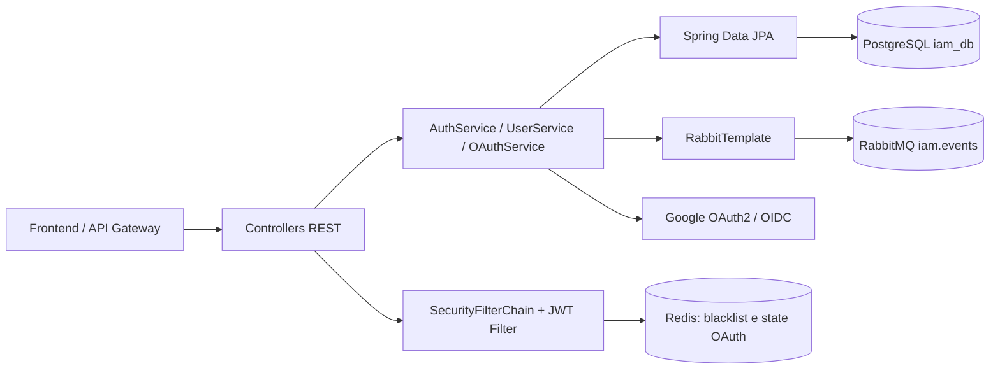

# Relatório Técnico Final — Migração do IAM Service

## 1. Identificação do projeto

| Item | Descrição |
|---|---|
| Projeto | PROMPTUARIO_CORPORATIVO |
| Microsserviço | IAM Service (`backend-java/iam-service`) |
| Migração | FastAPI/Python para Java 21 e Spring Boot 3.3.4 |
| Data de elaboração | 05 de novembro de 2026 |
| Escopo | Fases 1 a 9 e revisões das Tasks #20 e #21 |

O IAM Service centraliza identidade, autenticação, autorização baseada em papéis e ciclo de vida de contas. A migração preservou a persistência em PostgreSQL (`iam_db`), a revogação de tokens com Redis, eventos em RabbitMQ e os contratos REST sob `/api/v1`.

Tecnologias confirmadas no código: Java 21, Spring Boot 3.3.4, Spring Web MVC, Spring Security 6, Spring Data JPA/Hibernate 6, Flyway, PostgreSQL, Spring Data Redis, Spring AMQP, Nimbus JOSE JWT, Google Authenticator, Maven, Docker, Docker Compose, JUnit 5, Mockito e Testcontainers.

## 2. Resumo executivo

O serviço Python/FastAPI foi substituído por uma aplicação Spring Boot organizada em camadas. Foram implementados schema versionado, entidades JPA, records de contrato, autenticação JWT HS256, refresh tokens persistidos apenas como hash, blacklist Redis, regras de negócio transacionais, eventos de usuários, OAuth2 Google, TOTP, controladores REST e tratamento uniforme de erros.

Ao final, o módulo compila e a suíte Maven executada na revisão da Task #20 concluiu **19 testes sem falhas**. A imagem Docker foi construída e uma instância isolada respondeu ao healthcheck. Permanecem limitações documentadas: recuperação de senha ainda não entrega o token por e-mail/notificação; OAuth2 real depende de credenciais externas; e a imagem final não atingiu a meta de 250 MB usando o runtime Temurin requerido.

## 3. Arquitetura implementada



| Camada | Componentes e responsabilidade |
|---|---|
| Entrada | `AuthController`, `UserController`, `OAuthController` e `HealthController`. |
| Serviço | Autenticação, usuários, OAuth2, TOTP e blacklist. Escritas usam `@Transactional`. |
| Persistência | Entidades `User`, `RefreshToken`, `PasswordResetToken`, `OAuthAccount`; repositórios JPA. |
| Segurança | `SecurityConfig`, `JwtTokenProvider`, `JwtAuthenticationFilter`, BCrypt e `SecurityErrorResponder`. |
| Mensageria | `IamEventPublisher`, `UserCreatedEvent`, `UserDeactivatedEvent`, exchange configurável `iam.events`. |
| Configuração | `application.yml`, `JwtProperties`, `OAuthConfig`, `RedisConfig`; perfis `dev`, `prod` e `test`. |
| Testes | Unitários, integração JPA/Testcontainers e integração HTTP com PostgreSQL/Redis. |

O Gateway Python referencia o serviço pela URL interna `http://iam-service:8000` no Compose. O IAM expõe a porta do host `8001` para desenvolvimento direto.

## 4. Relatório das fases da migração

### Fase 1 — Bootstrap, Maven e configurações

- **Objetivo:** inicializar o módulo Java e infraestrutura básica.
- **Arquivos:** `pom.xml`, `application.yml`, `IamServiceApplication`, `JwtProperties`, `RedisConfig`.
- **Implementado:** dependências Web, JPA, Security, Redis, AMQP, Flyway, Actuator, Prometheus, OpenAPI, Nimbus, Google Authenticator e Testcontainers; porta 8000; configuração de PostgreSQL, Redis, RabbitMQ e JWT por ambiente.
- **Decisão/validação:** Java 21 e Spring Boot 3.3.4. A compilação Maven foi validada com JDK 21 após correção do ambiente que inicialmente usava Java 17.
- **Situação:** concluída.

### Fase 2 — Flyway e banco de dados

- **Arquivos:** `src/main/resources/db/migration/V1__init_iam_schema.sql`.
- **Implementado:** enum `user_role`; tabelas `users`, `refresh_tokens`, `password_reset_tokens` e `oauth_accounts`; FKs, cascata, unicidade e índices. Inclui seed idempotente do administrador.
- **Validação:** migração executada em PostgreSQL 15 efêmero durante os testes de persistência.
- **Situação:** concluída.

### Fase 3 — Entidades JPA e repositórios

- **Arquivos:** pacote `model/` e quatro repositórios em `repository/`.
- **Implementado:** UUID textual criado no Java, `Role`, timestamps Hibernate, relações lazy e proteção contra ciclos JSON. Consultas para e-mail case-insensitive, CPF, médicos ativos, OAuth e tokens; revogação global de refresh tokens por atualização em lote.
- **Validação:** `IamPersistenceIntegrationTest` usa Flyway/PostgreSQL real.
- **Situação:** concluída.

### Fase 4 — DTOs e validações Jakarta

- **Arquivos:** 15 records no pacote `dto/`.
- **Implementado:** contratos de login, refresh, senha, pacientes, usuários e médicos; validações Jakarta e serialização `snake_case` em tokens e campos de resposta.
- **Validação:** `DtoContractTest` confirma validação e nomes JSON dos tokens.
- **Situação:** concluída.

### Fase 5 — JWT, BCrypt e Redis

- **Arquivos:** `JwtTokenProvider`, `JwtAuthenticationFilter`, `TokenBlacklistService`, `SecurityConfig`.
- **Implementado:** JWT HS256 com `sub`, `role`, `email`, `type`, `iat`, `exp` e `jti`; BCrypt custo 12; sessão stateless; refresh tokens e blacklist com TTL restante do token.
- **Validação:** testes de provider, filtro, blacklist e configuração. O teste BCrypt foi ajustado porque a API usada inicialmente não expunha `getStrength()`.
- **Situação:** concluída.

### Fase 6 — Serviços e RabbitMQ

- **Arquivos:** `AuthService`, `UserService`, publisher e records de eventos.
- **Implementado:** login, rotação, logout, troca/redefinição de senha, cadastro e desativação; hash SHA-256 para tokens persistidos; `UserCreatedEvent` e `UserDeactivatedEvent` com headers de rastreabilidade.
- **Validação:** testes unitários de rotação, revogação e publicação.
- **Situação:** concluída com pendência funcional: `forgotPassword` grava o hash, mas não encaminha o token em texto a um provedor de e-mail/notificação.

### Fase 7 — Google OAuth2 e TOTP

- **Arquivos:** `OAuthConfig`, `OAuthService`, `OAuthController`, `TwoFactorService`.
- **Implementado:** autorização Google com `state` de uso único no Redis, troca de código, consulta de perfil OIDC, provisionamento de paciente, vínculo em `oauth_accounts` e retorno de tokens internos. TOTP gera segredo Base32, URI `otpauth` e valida códigos.
- **Validação:** `TwoFactorServiceTest`. OAuth real não foi executado pois exige credenciais e URIs cadastradas no Google.
- **Situação:** concluída condicionada à configuração externa.

### Fase 8 — REST e erros

- **Arquivos:** controladores, exceções de domínio, `ApiErrorResponse`, `GlobalExceptionHandler` e ajustes nos serviços.
- **Implementado:** endpoints canônicos, `@EnableMethodSecurity`, `@PreAuthorize`, regra de atendente apenas criar paciente, atualização pelo próprio usuário ou administrador e healthcheck.
- **Validação:** testes existentes e integração HTTP.
- **Situação:** concluída; complementada pela Task #20.

### Fase 9 — Docker e Testcontainers

- **Arquivos:** `Dockerfile`, `backend/docker-compose.yml`, `AuthIntegrationTest`.
- **Implementado:** build multi-stage, execução não-root, Compose para `iam-service`, e cinco cenários HTTP com PostgreSQL/Redis reais.
- **Validação:** Testcontainers confirmou login, cadastro, logout/blacklist, JWT revogado e desativação.
- **Situação:** concluída funcionalmente; tamanho da imagem revisto na Task #21.

## 5. Revisão das Tasks #20 e #21

### Task #20 — controladores e erros

Os controladores e autorizações já existiam na Fase 8. A revisão identificou que `@RestControllerAdvice` não captura respostas criadas dentro do filtro JWT nem as produzidas pelo mecanismo de autorização do Spring Security. Foram adicionados `SecurityErrorResponder`, `AuthenticationEntryPoint` e `AccessDeniedHandler`, todos emitindo `ApiErrorResponse`. Também foi incluído tratamento de JSON malformado como HTTP 400. A revisão terminou com `mvn clean test`: 19 testes, 0 falhas.

### Task #21 — Docker e Testcontainers

O Dockerfile, Compose e testes já existiam na Fase 9. A auditoria confirmou build real, usuário `appuser`, healthcheck saudável e resposta de `/healthz`. A cópia do JAR passou a usar `COPY --chown`, eliminando uma camada duplicada. A imagem passou de 588 MB para 438,5 MB, ainda acima da meta de 250 MB. O startup completo via Compose foi impedido no ambiente de validação por uma instância externa ocupando a porta host 5672; o IAM foi iniciado isoladamente na rede Docker com PostgreSQL/Redis e respondeu corretamente.

## 6. Endpoints REST implementados

| Método | Endpoint | Finalidade | Autenticação | Permissões |
|---|---|---|---|---|
| GET | `/healthz` | Healthcheck do IAM | Não | Pública |
| POST | `/api/v1/auth/login` | Autenticar | Não | Pública |
| POST | `/api/v1/auth/refresh` | Rotacionar token | Não | Pública |
| POST | `/api/v1/auth/logout` | Revogar sessão | JWT | Autenticado |
| POST | `/api/v1/auth/change-password` | Alterar senha | JWT | Próprio usuário |
| POST | `/api/v1/auth/forgot-password` | Solicitar recuperação | Não | Pública |
| POST | `/api/v1/auth/reset-password` | Redefinir senha | Não | Pública |
| POST | `/api/v1/auth/register-patient` | Autocadastro | Não | Pública |
| GET | `/api/v1/auth/oauth/google` | Iniciar Google OAuth | Não | Pública |
| GET | `/api/v1/auth/oauth/google/callback` | Callback OAuth | Não | Pública |
| GET | `/api/v1/auth/oauth/accounts` | Provedores vinculados | JWT | Autenticado |
| GET | `/api/v1/users` | Listar usuários | JWT | ADMIN |
| POST | `/api/v1/users` | Criar usuário | JWT | ADMIN/ATTENDANT* |
| GET | `/api/v1/users/me` | Perfil atual | JWT | Autenticado |
| GET | `/api/v1/users/doctors` | Médicos ativos | Não | Pública |
| GET | `/api/v1/users/{id}` | Consultar usuário | JWT | ADMIN |
| PUT | `/api/v1/users/{id}` | Atualizar cadastro | JWT | Próprio/ADMIN |
| PUT | `/api/v1/users/{id}/role` | Alterar papel | JWT | ADMIN |
| DELETE | `/api/v1/users/{id}` | Desativar | JWT | ADMIN |
| POST | `/api/v1/users/{id}/reactivate` | Reativar | JWT | ADMIN |

\* ATTENDANT é bloqueado caso tente criar papel diferente de `PATIENT`.

## 7. Segurança e autenticação

- Senhas usam `BCryptPasswordEncoder(12)`; nenhum segredo real é registrado neste documento.
- Access tokens são JWT HS256, e refresh tokens possuem `jti`; somente o hash SHA-256 do refresh é persistido.
- A blacklist Redis grava `blacklist:<token>` com TTL igual à vida restante.
- Roles: `ADMIN`, `DOCTOR`, `ATTENDANT`, `PATIENT`; o filtro converte em `ROLE_<papel>`.
- OAuth2 Google protege o callback por `state` no Redis e exige e-mail verificado no perfil retornado.
- TOTP usa `GoogleAuthenticator`; o login valida código quando 2FA está ativo.
- Recuperação de senha expira em duas horas e invalida refresh tokens após reset.

**Limitações/riscos:** tokens enviados ao frontend no callback OAuth aparecem como parâmetros de consulta por requisito do contrato e podem ser registrados por intermediários; deve-se preferir código de curta duração em evolução futura. Eventos RabbitMQ são publicados durante a transação, sem padrão outbox. O envio do token de recuperação de senha ainda não foi integrado a canal de entrega. A configuração real do OAuth depende de variáveis externas.

## 8. Testes e validações

| Teste | Classe/arquivo | Objetivo | Resultado/evidência |
|---|---|---|---|
| Persistência | `IamPersistenceIntegrationTest` | Flyway, entidades e repositórios em PostgreSQL 15 | Aprovado em `mvn clean test` |
| Contratos DTO | `DtoContractTest` | Jakarta Validation e JSON | Aprovado |
| JWT/filtro | `JwtTokenProviderTest`, `JwtAuthenticationFilterTest` | Claims, assinatura, roles e erro JSON | Aprovado |
| Redis | `TokenBlacklistServiceTest` | TTL e blacklist | Aprovado |
| Serviços | `AuthServiceTest`, `UserServiceTest` | Rotação e revogação | Aprovado |
| Mensageria | `IamEventPublisherTest` | routing e headers | Aprovado |
| TOTP | `TwoFactorServiceTest` | segredo, URI e código atual | Aprovado |
| HTTP E2E | `AuthIntegrationTest` | cinco fluxos com PostgreSQL/Redis Testcontainers | Aprovado |

Evidência mais recente registrada: `mvn clean test` concluiu **19 testes, 0 falhas, 0 erros**. Docker é requisito para as classes Testcontainers.

## 9. Docker e infraestrutura

O Dockerfile usa `maven:3.9-eclipse-temurin-21-alpine` no builder e `eclipse-temurin:21-jre-alpine` no runtime. O runtime instala somente `curl` para o healthcheck, cria `appuser` e executa `java -XX:+UseContainerSupport -XX:MaxRAMPercentage=75.0 -jar app.jar`.

| Recurso | Configuração confirmada |
|---|---|
| Serviço direto | `http://localhost:8001` |
| Porta no container | 8000 |
| Health | `GET /healthz` |
| Banco | `db-iam:5432/iam_db` |
| Redis | `redis:6379` |
| RabbitMQ | `rabbitmq:5672` |
| Rede | `backend` |

Comandos validados:

```bash
cd backend-java/iam-service
mvn clean test
docker build -t promptuario-iam-service:task21-optimized .
cd ../../backend
docker compose config --quiet
docker compose up -d --build iam-service
```

O último comando depende de as portas host da infraestrutura estarem livres; no ambiente de auditoria a porta 5672 estava ocupada por outro RabbitMQ.

## 10. Git, branches e Pull Requests

O histórico disponível registra, entre outros, os commits de bootstrap (`29eae0c`), entidades (`eb0ceec`), DTOs (`c36d9c4`), segurança (`140e824`), serviços/eventos (`454819b`), OAuth/TOTP (`f7dcd76`), controladores (`18dad08`), Docker/Testcontainers (`6455f63`), correções CI (`95be97a`) e ajustes da Task #20 (`2a6e5ec`). As branches de fase incluíram `feature/iam-jwt-security-redis-blacklist`, `feature/iam-business-services-rabbitmq-events`, `feature/iam-google-oauth2-two-factor-auth`, `feature/iam-rest-controllers-exception-handling` e `feature/iam-docker-testcontainers-integration`.

A PR #59 foi identificada como a integração da Fase 9 em `develop`. Os logs consultados mostraram falhas de CI por referências obsoletas a diretórios Python inexistentes; a correção posterior está registrada no histórico. Não se afirma aqui o estado de merge de outras PRs sem evidência local.

## 11. Dificuldades e soluções comprovadas

| Problema | Causa | Solução/evidência |
|---|---|---|
| Java 17 no Maven | `release 21 not supported` | Execução com Java 21. |
| Testcontainers antigo | Docker exigia API superior | Atualização para 1.21.4. |
| Módulo Redis Testcontainers | Dependência inadequada | Uso de `GenericContainer` Redis. |
| CI Python falhando | Paths de serviços removidos | Matriz CI alinhada à estrutura atual. |
| Erros de segurança fora do advice | Filtro/Spring Security não passam pelo MVC advice | Respondedor JSON e handlers de segurança. |
| Imagem duplicada | `chown` após `COPY` | `COPY --chown`, redução medida. |

## 12. Resultados alcançados

A migração entrega uma base Java modular e testável para IAM, com persistência versionada, autenticação e autorização stateless, integrações de infraestrutura, contratos JSON validados, endpoints REST e cobertura de integração. A organização por camadas separa web, regras de negócio, persistência, segurança e mensageria, sem alegação de ganho de desempenho não medido.

## 13. Pendências e recomendações

1. Integrar e-mail/notificação para entrega segura do token de recuperação.
2. Avaliar fluxo OAuth de código curto em vez de tokens na URL de callback.
3. Avaliar transactional outbox para garantir consistência entre banco e RabbitMQ.
4. Configurar credenciais e redirect URI Google por ambiente, fora do repositório.
5. Decidir se a meta de imagem <250 MB é mandatória; atingi-la provavelmente requer runtime customizado (`jlink`) e mudança da exigência de imagem base.
6. Executar o Compose completo em host sem conflito na porta 5672 e validar o Gateway ponta a ponta.

## 14. Conclusão

O IAM Service foi migrado de FastAPI para Java 21/Spring Boot 3 com as capacidades centrais de identidade, autorização, tokens, persistência, mensageria e operação em container implementadas no código. As revisões finais reforçaram a consistência dos erros HTTP e validaram build, healthcheck e testes de integração. O módulo encontra-se tecnicamente apto para continuidade da integração, observadas as pendências de entrega de recuperação de senha, configuração externa OAuth, consistência de eventos e decisão sobre o orçamento de tamanho da imagem.
